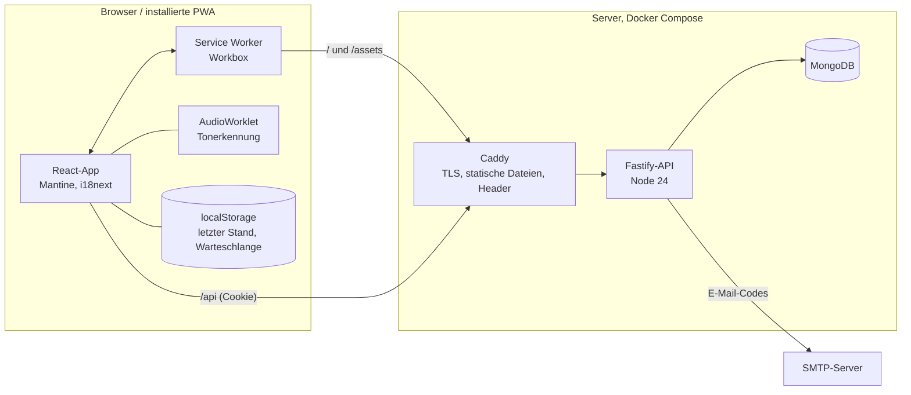
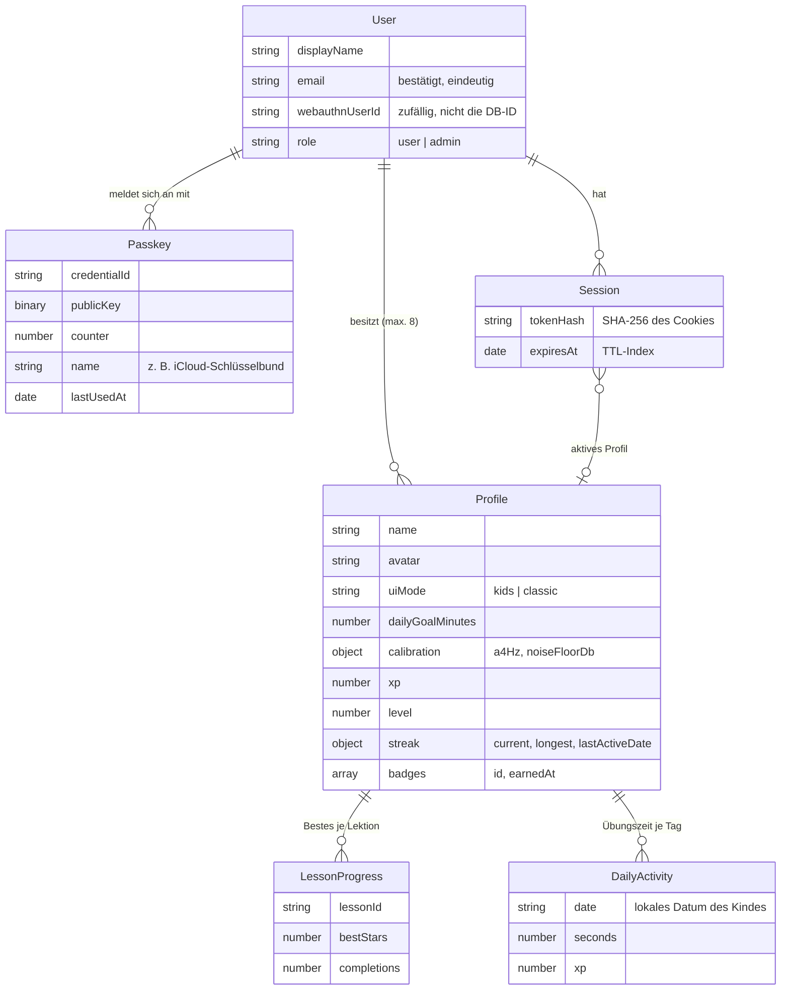
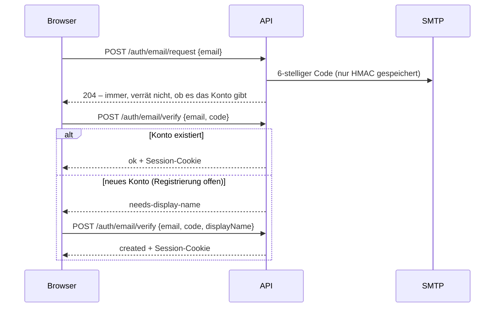
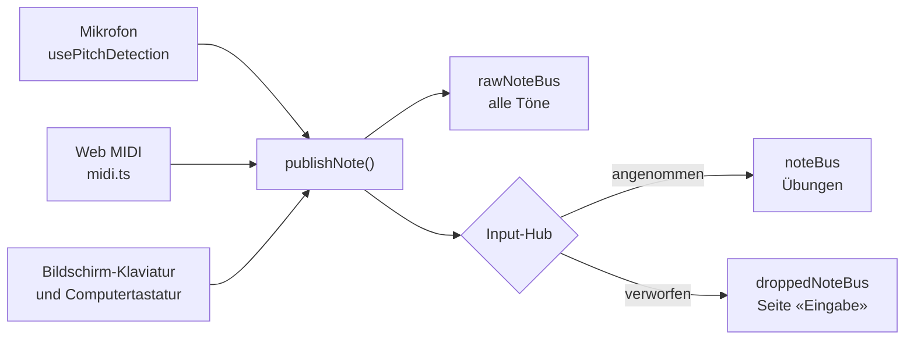
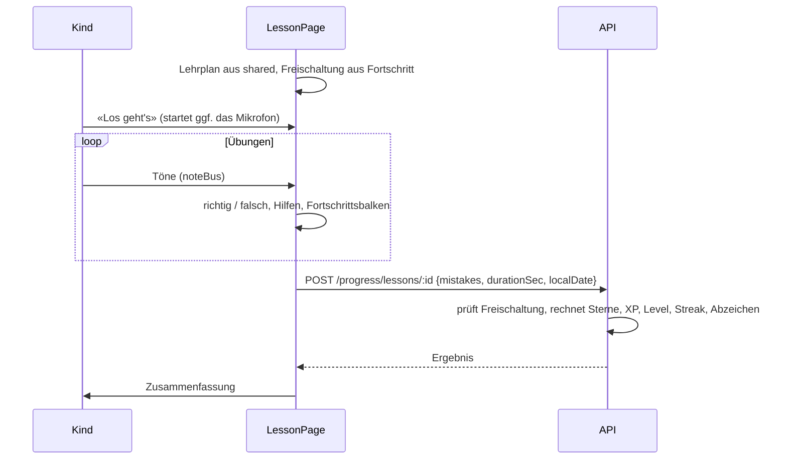
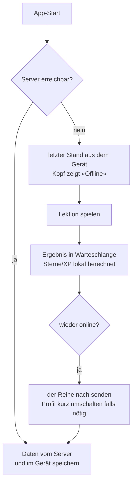

# Architektur

Überblick für Entwicklerinnen und Entwickler: Aufbau, Datenmodell und die wichtigsten Abläufe.
Details zur Tonerkennung stehen in [tonerkennung.md](tonerkennung.md), zum Lehrplan in
[inhalte.md](inhalte.md).

## Bausteine

Ein npm-Workspace-Monorepo mit drei Paketen:

| Paket     | Inhalt                                                                                                                                                                                                                             |
| --------- | ---------------------------------------------------------------------------------------------------------------------------------------------------------------------------------------------------------------------------------- |
| `shared/` | Von Client und Server genutzt: App-Konfiguration, zod-Schemas der API, Musik-Hilfsfunktionen, `NoteEvent`, **Lehrplan**, Regeln für Sterne/XP/Streak, Abzeichen. TypeScript-Quellen werden direkt importiert (kein eigener Build). |
| `server/` | Fastify-API: Routen, Mongoose-Modelle, Sessions, E-Mail-Codes, WebAuthn. Build mit tsup.                                                                                                                                           |
| `client/` | React-PWA mit Vite: Seiten, Eingaben (Mikrofon, MIDI, Bildschirm), Lektionen, Notation (VexFlow), Offline-Speicher.                                                                                                                |

Weil der Lehrplan und die Belohnungsregeln in `shared/` liegen, rechnet der Server Sterne, XP,
Freischaltung und Abzeichen selbst nach – der Client schickt nur Fehlerzahl, Dauer und Datum.
Offline nutzt der Client dieselben Funktionen, damit die Anzeige mit dem späteren Serverergebnis
übereinstimmt.

## Datenmodell

Kurzlebig, mit TTL-Index: `AuthChallenge` (WebAuthn-Challenge, 5 Min., per Cookie referenziert),
`EmailCode` (HMAC des Codes, 10 Min.). Einzeldokument `AppSettings` (`registrationOpen`).
Was davon personenbezogen ist und wie lange es bleibt: [datenschutz.md](datenschutz.md).

## API

Alle Routen unter `/api`, JSON, Validierung mit zod (Schemas in `shared/src/schemas/`).

| Bereich       | Routen                                                                                                                                                                             |
| ------------- | ---------------------------------------------------------------------------------------------------------------------------------------------------------------------------------- |
| öffentlich    | `GET /config`, `GET /health`                                                                                                                                                       |
| `/auth/email` | `POST /request` (Code senden), `POST /verify` (anmelden oder Konto anlegen)                                                                                                        |
| `/auth`       | `POST /login/options`, `POST /login/verify` (Passkey), `POST /logout`, `GET /me`                                                                                                   |
| `/passkeys`   | `GET /`, `POST /options`, `POST /verify` (hinzufügen), `PATCH /:id`, `DELETE /:id`                                                                                                 |
| `/account`    | `PATCH /` (Name), `POST /email/request`, `POST /email/verify` (Adresse ändern), `DELETE /` (Konto löschen), `PUT`/`DELETE /pin`, `POST /pin/verify`, `POST /pin/lock` (Eltern-PIN) |
| `/profiles`   | `GET /`, `POST /`, `PATCH /:id`, `DELETE /:id`, `POST /select`                                                                                                                     |
| `/progress`   | `GET /?date=` (Fortschritt des aktiven Profils), `POST /lessons/:lessonId` (Lektion beendet)                                                                                       |
| `/admin`      | `GET /settings`, `PUT /settings` (nur Rolle `admin`)                                                                                                                               |

Querschnitt (`server/src/app.ts`): Helmet mit strikter CSP für JSON, Cookies, Rate-Limits (global
300/min, strenger für Anmeldung und E-Mail-Codes), Origin-Prüfung für alle zustandsändernden Anfragen
(CSRF-Schutz zusätzlich zu `SameSite=Lax`), einheitliche Fehlerantworten `{ "error": "CODE" }`.
Im Log stehen Methode und Pfad, aber keine IP-Adressen.

## Anmeldung

**Registrierung und E-Mail-Login** sind derselbe Ablauf; der Server entscheidet, ob die Adresse schon
ein Konto hat:

**Passkeys** werden danach unter «Konto» hinzugefügt (`/passkeys/options` → `navigator.credentials.create`
→ `/passkeys/verify`). Login mit Passkey ohne Benutzernamen (auffindbare Credentials):
`/auth/login/options` → `navigator.credentials.get` → `/auth/login/verify`. Die Challenge liegt
serverseitig und wird über ein kurzlebiges httpOnly-Cookie (`klavio_ch`) gefunden; sie gilt einmal.

**Session:** zufälliges Token im Cookie `klavio_sid` (httpOnly, `Secure`, `SameSite=Lax`,
`Path=/api`, 60 Tage), in der Datenbank nur als SHA-256. Jede Anmeldung erzeugt ein neues Token. Die
Session merkt sich das aktive Profil.

**Elternbereich:** Ist eine Eltern-PIN gesetzt, verlangen Konto, Passkeys, Verwaltung sowie Anlegen,
Ändern und Löschen von Profilen einen offenen Elternbereich (`requireParent`, Fehler
`PARENT_LOCKED`). Er öffnet sich durch die PIN oder eine frische Anmeldung (das ist der Erwachsene) für
15 Minuten und schliesst sich, sobald ein Profil gewählt wird – der Moment, in dem das Gerät an ein
Kind geht. Lernen, Profil wählen und die Mikrofon-Kalibrierung bleiben ohne PIN möglich.

## Eingaben

Alle Quellen liefern dieselbe Struktur `NoteEvent` (`shared/src/music/noteEvent.ts`): Typ, MIDI-Nummer,
Anschlagstärke, Zeit (`performance.now()`), Quelle, beim Mikrofon die Abweichung in Cent. Der
Input-Hub setzt die Priorität um: MIDI vor Mikrofon, Echo-Schutz nach Bildschirm-Tasten,
Stummschaltung des Mikrofons während die App selbst Musik abspielt. Übungen kennen die Quelle nicht.

## Lektionen

Übungstypen (`client/src/lesson/`): `FindKeyExercise`, `PlayAlongExercise`, `ReadNoteExercise`,
`SongExercise`, `RhythmExercise`. Rundenbasierte Übungen teilen sich `useRoundTask`. Notation zeichnet
`notation/Staff.tsx` mit VexFlow; die Bibliothek wird erst geladen, wenn Noten gebraucht werden.

## Offline

- Der **Service Worker** (Workbox) speichert die gebaute App inklusive Notenschrift und Worklet vorab.
  `clientsClaim` sorgt dafür, dass er schon beim ersten Besuch übernimmt. Neue Versionen warten, bis
  der Nutzer im Banner «Neu laden» wählt. API-Anfragen beantwortet er nie aus dem Cache.
- **`offline/storage.ts`:** fehlertoleranter Zugriff auf `localStorage` (letzter Stand von Konto und
  Profilen, Fortschritt je Profil, Warteschlange). Beim Abmelden werden Stand und Fortschritt gelöscht.
- **`offline/queue.ts`, `offline/sync.ts`:** Warteschlange und Übertragung. Der Server nimmt Ergebnisse
  bis 14 Tage zurück an; ein später übertragener Tag ändert den Streak nicht mehr.

## Darstellung

- Mantine 9 mit CSS Modules; zwei Themes pro Profil: **Kids** (grosse Schrift, runde Formen,
  Maskottchen gross) und **Classic** (ruhiger, kompakter). Gleiche Inhalte.
- **Farbschema** hell, dunkel oder automatisch (pro Gerät gespeichert, Menü). Eigene Farben stehen als
  Variablen mit hellem und dunklem Wert in `client/src/theme/global.css` (`--klavio-…`); neue
  Komponenten bitte darüber statt mit festen Farben. VexFlow zeichnet die Noten in der passenden Tinte.
- **Figuren** (`components/Figure.tsx`): alle Profilfiguren mit Stimmungen (happy, cheer, think, listen)
  und Bewegung; `Buddy` zeigt die Figur des aktiven Profils als Begleiter, `ProfileAvatar` dieselbe
  Figur im runden Rahmen.
- Sprachen: de-CH (Schweizer Schreibweise, kein ß – ein Test prüft das) und en. Lehrplantexte stehen
  im Lehrplan selbst, UI-Texte in `client/src/i18n/`.
- Barrierefreiheit: axe-core prüft die Hauptseiten in beiden Themes auf WCAG 2.1 AA (E2E). Klaviatur,
  Notenlinien und Lernpfad haben Textalternativen; Animationen respektieren `prefers-reduced-motion`.
