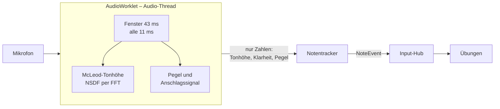

# Tonerkennung über das Mikrofon

Wie Klavio Töne eines echten Klaviers erkennt, welche Parameter das Verhalten bestimmen und wie
die Genauigkeit gemessen wird. Code: `client/src/audio/`.

## Ablauf



- **`microphone.ts`** öffnet das Mikrofon. Echo-Unterdrückung, Rauschfilter und automatische
  Verstärkung des Browsers sind ausgeschaltet: Sie sind für Sprache gemacht und verfälschen Klavierklang.
  Der `AudioContext` wird im Klick des Nutzers erzeugt (iOS startet Audio nur nach einer Geste).
- **`pitch/pitch-processor.ts`** (AudioWorklet) nimmt die 128-Sample-Blöcke entgegen und schickt pro
  Analyse ein kleines Objekt an die Seite. **Audio verlässt den Worklet nie** und wird nirgends
  gespeichert oder übertragen.
- **`pitch/analyzer.ts`** führt das gleitende Fenster und berechnet pro Schritt Pegel, Anschlagssignal
  und Tonhöhe. Derselbe Code läuft im Worklet, in den Tests und auf Aufnahmen.
- **`pitch/mpm.ts`** – McLeod Pitch Method: normalisierte Differenzfunktion (NSDF), Autokorrelation per
  FFT (O(N log N)), erster Hauptgipfel über 90 % des höchsten, parabolische Interpolation.
  Liefert eine Liste von Kandidaten, damit später ein mehrstimmiger Detektor hinter derselben
  Schnittstelle (`PitchDetector`) Platz hat.
- **`pitch/tracker.ts`** macht aus den Analysen `note-on`/`note-off`-Ereignisse.
- **`usePitchDetection.ts`** verbindet alles und veröffentlicht die Ereignisse über `publishNote()`.

## Notentracker

| Regel                    | Wert                                                                                                       | Warum                                                                                                                                                                                                    |
| ------------------------ | ---------------------------------------------------------------------------------------------------------- | -------------------------------------------------------------------------------------------------------------------------------------------------------------------------------------------------------- |
| Rauschschwelle           | Raumrauschen + 8 dB (ohne Einrichtung −60 dBFS), Grenzen −75 … −30                                         | Leise Töne zählen noch, Rauschen hat ohnehin keine stabile Tonhöhe.                                                                                                                                      |
| Hysterese beim Loslassen | 6 dB unter der Schwelle                                                                                    | Ein klingender Ton flackert nicht an der Schwelle.                                                                                                                                                       |
| Stimmungstoleranz        | ±35 Cent                                                                                                   | Verstimmte Klaviere werden erkannt, Töne zwischen zwei Tasten nicht.                                                                                                                                     |
| Klarheit                 | ≥ 0,8 für neue Töne, ≥ 0,6 zum Halten                                                                      | Tiefe Bassnoten sind weniger periodisch; ein klingender Ton bricht nicht ab.                                                                                                                             |
| Stabilität bis Note-on   | 2 Analysen (≈ 22 ms)                                                                                       | Kurze Ausreisser beim Anschlag werden nicht gemeldet.                                                                                                                                                    |
| Loslassen                | 4 leise Analysen (≈ 43 ms)                                                                                 |                                                                                                                                                                                                          |
| Anschlag                 | Hochtonanteil springt ≥ 6 dB gegenüber der vorherigen Analyse                                              | Der Hammer erzeugt breitbandiges Geräusch; obere Teiltöne eines klingenden Tons sterben schnell. So wird auch dieselbe Taste mit Pedal erneut erkannt, das langsame Schweben der drei Saiten aber nicht. |
| Dieselbe Taste nochmals  | nur mit Anschlag **und** ≥ 2 dB lauter als in den letzten 150 ms (bzw. vor dem letzten Loslassen, bis 1 s) | Aussetzer oder Klicks im Audiostrom sind keine neuen Anschläge.                                                                                                                                          |
| Oktav-/Duodezimsprünge   | ohne Anschlag ignoriert                                                                                    | Beim Ausklingen springt die Erkennung manchmal auf einen Teilton; jeder echte Tastendruck hat einen Anschlag.                                                                                            |
| Tonbereich               | A1 (MIDI 33) bis C7 (MIDI 96)                                                                              |                                                                                                                                                                                                          |

Die Werte stehen als Voreinstellungen in `NoteTracker` und lassen sich pro Instanz überschreiben.

## Einrichtung pro Profil

Der Assistent (`/mic-setup`, `MicSetupPage.tsx` und `calibration.ts`):

1. **Mikrofon erlauben.**
2. **Raumrauschen:** 3 s Ruhe; gespeichert wird das 75. Perzentil der Pegel (`noiseFloorDb`), damit
   einzelne Klicks es nicht hochziehen, ein Lüfter aber berücksichtigt wird.
3. **Kammerton:** Das A über dem mittleren C halten. Ausgewertet wird nur der ausgeklungene Teil
   (ab 300 ms nach dem Anschlag, Klarheit ≥ 0,9, höchstens einen Halbton von 440 Hz entfernt), bis
   60 Analysen beisammen sind; der Median ergibt `a4Hz` (415–466 Hz). Direkt nach dem Anschlag liegt die
   gemessene Tonhöhe einige Cent zu hoch, darum wird der Anfang übersprungen.
4. **Probespielen:** drei verschiedene Töne.

Gespeichert werden nur `a4Hz` und `noiseFloorDb` im Profil. Die Testseite `/mic-test` zeigt den
erkannten Ton, die Abweichung in Cent, den Pegel mit Schwelle und die letzten Ereignisse.

## Zusammenspiel mit anderen Eingaben

- **MIDI hat Vorrang:** Solange ein MIDI-Gerät verbunden ist, verwirft der Input-Hub Mikrofon-Töne
  (`client/src/input/inputHub.ts`) – das Mikrofon würde das Digitalpiano sonst doppelt hören.
- **Echo-Schutz:** Nach einer Taste der Bildschirm-Klaviatur (die selbst klingt) werden Mikrofon-Töne
  600 ms lang verworfen.
- **Eigene Wiedergabe:** Während «Anhören» in Liedern und Rhythmus ist das Mikrofon stummgeschaltet.
- **Metronom:** Die Klicks sind kurze Rauschimpulse ohne Tonhöhe und lösen keine Töne aus.
- **Rhythmus:** Die Erkennungsverzögerung des Mikrofons (40 ms) wird vor der Bewertung abgezogen.

## Genauigkeit

Gemessen mit echten Aufnahmen eines Steinway-Flügels (University of Iowa Musical Instrument Samples,
frei verwendbar), C2–C6, je pp/mf/ff = 147 Töne, mit Raumrauschen-Kalibrierung wie im Assistenten.
«Sauber» heisst: richtiger Ton, keine weiteren (falschen oder doppelten) Töne in den ersten 1,5 s,
gemeldet innert 100 ms nach dem Anschlag. Ziel war > 95 %.

| Dynamik | richtig | sauber | ≤ 100 ms | Median | 95 %  |
| ------- | ------- | ------ | -------- | ------ | ----- |
| pp      | 98,0 %  | 95,9 % | 95,9 %   | 39 ms  | 72 ms |
| mf      | 100 %   | 100 %  | 100 %    | 37 ms  | 60 ms |
| ff      | 100 %   | 100 %  | 100 %    | 37 ms  | 60 ms |
| gesamt  | 99,3 %  | 98,6 % | 98,6 %   | 37 ms  | 60 ms |

Die Latenz ist ab dem Anschlag im Signal gemessen; dazu kommt die Eingangslatenz des Geräts (typisch
5–20 ms). Verbleibende Fehler: pp A♯4 knapp über 100 ms, pp C6 liegt nur rund 7 dB über dem
Raumrauschen.

**Grenzen:** Stimmen, Gesang und andere Instrumente im Raum werden ebenfalls als Töne erkannt.
Akkorde werden nicht erkannt (einstimmig). Sehr leise Töne in einem lauten Raum fallen unter die
Schwelle.

## Tests

```bash
npm test                   # u. a. client/src/audio/pitch/pitch.test.ts
npm run samples:fetch      # lädt die Aufnahmen einmalig nach .cache/piano-samples (≈ 220 MB Download,
                           # 29 MB gespeichert, git-ignoriert); danach läuft samples.test.ts automatisch
cat .cache/piano-samples-report.txt
```

- **`pitch.test.ts`** – synthetische Klaviertöne (inharmonische Teiltöne, schwacher Grundton im Bass,
  Hammergeräusch): FFT, MPM, alle Töne C2–C6 genau einmal und innert 100 ms, Melodie mit wiederholter
  Taste, Kalibrierung, zu stark verstimmte Töne, Loslassen, 44,1 kHz, Klick und Aussetzer im Audiostrom,
  losgelassene und neu angeschlagene Taste.
- **`samples.test.ts`** – die echten Aufnahmen; schlägt fehl, wenn weniger als 95 % sauber erkannt werden.
  Das Ladeskript `scripts/fetch-piano-samples.mjs` holt per HTTP-Range nur den Anfang jeder Datei,
  sucht den Anschlag (Rückwärtssuche vom Hüllkurven-Maximum, robust gegen Klicks und Tastengeräusche)
  und speichert 0,3 s davor bis 2 s danach als Mono-WAV.
- **`calibration.test.ts`** – Raumrauschen und Kammerton (432–452 Hz auf 1 Hz genau).
- **E2E `mic.spec.ts`** – Chromium spielt eine erzeugte WAV-Datei als virtuelles Mikrofon ab; der Test
  durchläuft den Assistenten (misst 440 Hz) und prüft, dass die Testseite genau A4, C4, E4, G4, C5 meldet.

Wer Parameter ändert, sollte beide Testarten laufen lassen: Die synthetischen Töne zeigen, ob ein
Grundprinzip bricht, die Aufnahmen, ob es in der Praxis besser oder schlechter wird.
